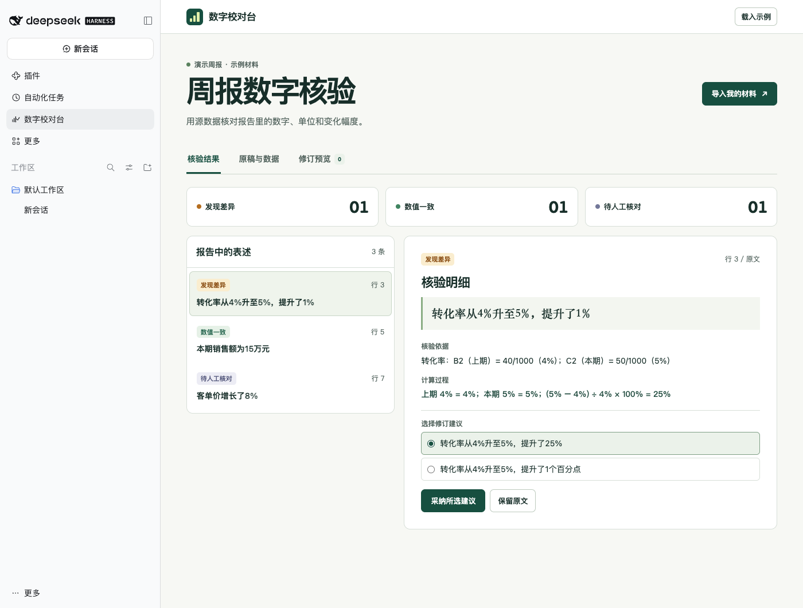

# 数字校对台 · DeepSeek Harness

当转化率从 4% 升到 5%，周报该写「增长 25%」还是「提高 1 个百分点」？两种写法都成立。本插件将已经写好的中文周报与两期 CSV 对照，显示原句、表格位置和算式。作者逐条选择修订，最后导出 Markdown。

个人开发的非官方社区插件，包名为 `dsh-report-auditor`。



## 安装与试用

在 DeepSeek Harness 的「插件 → 添加插件」中粘贴以下地址。也可以粘贴本地安装包的绝对路径。

```text
github:a348579184/dsh-report-auditor
```

从侧边栏打开「数字校对台」，试试内置的演示周报。在「原稿与数据」里可直接粘贴 CSV 和 Markdown，或分别选择本地文件。列名可以映射并记住，下次换文件即可复用。

默认 CSV 第一行是表头，每行一个指标：

```csv
指标,上期,本期,单位
转化率,40/1000,50/1000,%
销售额,12,15,万元
```

原稿可以直接写：

```text
转化率从 4% 升到 5%，环比增长 1%。
本期销售额为 150000 元。
```

同一行记录的两期数值应采用同一指标定义。以百分数录入时，单位填 `%`，单元格里的 `4` 表示 4%。也可像示例一样提供分子和分母。用「上期／本期」表示相邻两期。同比需要明确标出上年同期。

## 核验与修订

- 在结果中选择原句，查看它引用的 CSV 单元格及计算过程。上例的相对增幅为 (5% − 4%) ÷ 4% = 25%，绝对变化为 1 个百分点。
- 对每个问题单独选用建议。遇到源表缺行、指标重名、比较口径含糊等情况，工作台会保留原句并提示人工查看。
- 在「修订预览」对照原稿，导出新的 Markdown 文件。工作台在本地执行，原稿和 CSV 保留在当前页面内存里。点击记住列名设置时只保存列名。
- 在 Harness 对话里也可以指定工具 `audit_report_numbers`，让 Agent 用同一套计算规则检查报告。经对话提交的材料遵循你在 Harness 中选择的模型与数据设置。

当前版本面向中文两期指标陈述。结果仅覆盖识别到的数字表述，未列出的文字仍需自行检查。数据采集、指标定义是否正确也需要作者确认。单次支持最多 500 条数据、32 列和 300 个含数字的报告片段。

## 开发

运行 `npm test` 执行校对用例，`npm run build` 重新生成客户端，`npm pack` 生成可安装的 tgz。源码和打包产物均包含在仓库内。校对引擎与工作台无需第三方运行时依赖。
